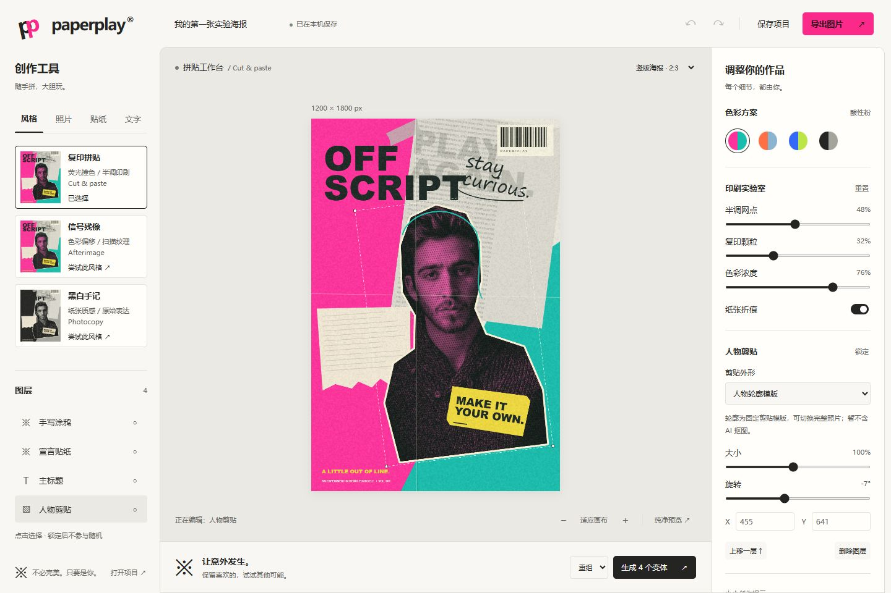

# Paperplay · 拼贴视觉生成器

下载仓库后，直接打开 **index.html** 即可在 Chrome 或 Edge 使用。不需要安装、启动服务或联网，照片和编辑数据在本机处理。

## 使用

1. 选择左侧的风格，或点击「照片」上传 JPG、PNG、WebP。也能把照片拖到画布区域。
2. 点击画面或图层列表选择元素，拖动调整位置。在右侧修改文字、大小、角度和坐标。
3. 调整色彩、半调网点、复印颗粒、纸张折痕。文字、贴纸、人物可独立移动和调整图层顺序。
4. 锁定不想移动的图层，再生成四个变体。选择「微调／重组／大胆」控制变化幅度。锁定保留该图层位置、旋转和大小；整张作品的配色仍可变化。
5. 导出 PNG 或 JPG。支持 1200、2400 像素宽，三种比例：2:3、1:1、9:16。
6. 使用「保存项目」下载含照片和参数的 JSON 文件，在左下角「打开项目」恢复。浏览器也会尝试自动保存最近的作品；需要长期保留时请下载项目文件。

方向键移动选中图层，Shift + 方向键每次移动 10 像素。Ctrl/Cmd + Z 撤销，Ctrl/Cmd + Shift + Z 重做。双击文字后可在右侧编辑。Delete 删除未锁定的图层。

## 当前版本范围

- 图像由本地 Canvas 程序处理，随机生成构图变体；没有调用付费生成式 AI 服务。
- 人物轮廓为固定形状的剪贴模版，**不是自动人物抠图**。可以改为椭圆或完整照片，后续可接入自动抠图。
- 主照片有一张，可添加文字与内置贴纸，最多 30 个可编辑图层；照片会缩小到最长边 1600 像素用于编辑。
- 大标题、人物、贴纸可编辑；背景纸片、条码和底部小字属于风格底图。
- 手机采用上下分区，调整面板位于画布下方。适合在桌面端进行精细编辑。

## 文件

- `index.html`、`style.css`、`app.js`：便于继续修改的源码。
- `assets.js`：内嵌示例照片，无外部图片加载依赖。

示例照片来源：[Unsplash 图像](https://images.unsplash.com/photo-1506794778202-cad84cf45f1d)。页面中的 OFF SCRIPT、MAKE IT YOUR OWN 等是可替换的示例创作文字。参考图片用于提取色彩、印刷和拼贴语言，没有直接作为生成结果。

## 已检查

在浏览器实际验证了文字修改、坐标调整、图层新增删除、锁定后生成四个变体、撤销、比例切换、照片替换、项目保存与重新打开、PNG 下载。过程未出现脚本报错。桌面、平板和手机布局已检查。
